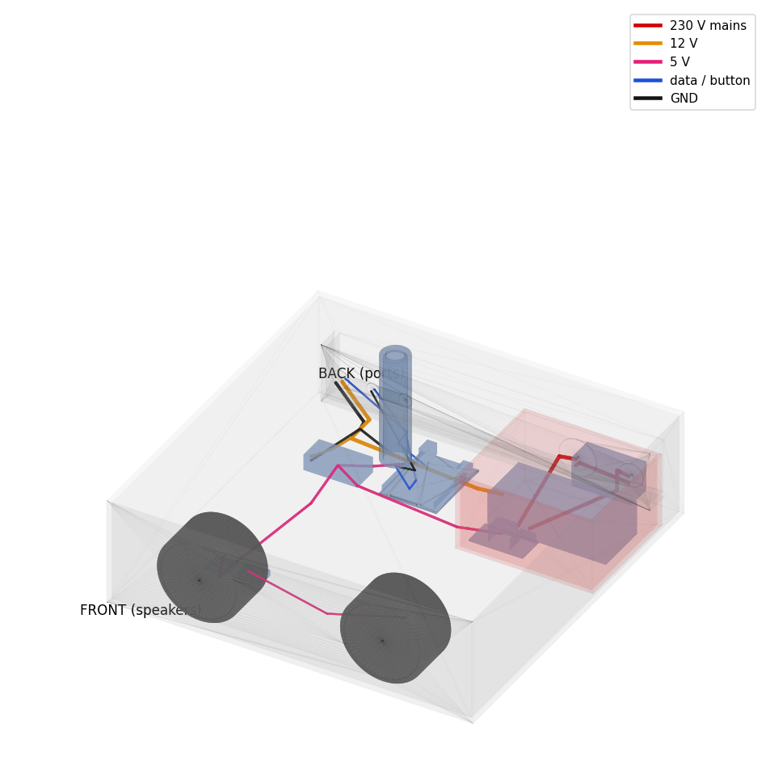

# Enclosure plan

Status: **block-out only**, no final CAD yet. The block-out models live in [`../cad/`](../cad/README.md). The idea is a record player: a fixed round platter (for looks, it does not turn) on a housing, with the electronics in the housing and the big button on a pipe rising from the platter centre.

## Layout (see `cad/make_blockout.py`)

| Item | Decision |
|------|----------|
| Housing | 340 x 340 x 100 mm block-out (will change, see "3D printing"), floor and front wall with the two speakers in one stiff piece |
| Speakers | Two round grilles on the front wall, left and right, so they look like part of the record player (hole 70 mm, speaker 80 mm assumed: check the datasheet) |
| Platter | Fixed disc, 315 mm, sits on top of the housing. Looks like a turntable, no motor |
| Button | 16 mm illuminated button in a cap on a hollow pipe (26 mm outside, 20 mm inside) from the platter centre; cable runs down the pipe into the housing |
| Arduino | Inside the housing. **USB-C is only reachable when the housing is opened** (no hole) |
| Back panel | A **recessed port pocket** (300 x 50 x 22 mm): mains inlet, outlet for the disco ball, strip connector, button connector and a spare, so plugs and cables do not stick out |
| Mains | Own compartment (own box and screw-on lid, wall to the low-voltage side) holding the C14 inlet with fuse, relay, 12 V brick and the Type 13 outlet |

## Cables are removable

- **Mains:** a standard cord (Swiss Type 12 plug on one end, IEC C13 on the other) into an IEC C14 panel inlet with a 5x20 mm fuse drawer. The relay switches the live wire to the Type 13 outlet for the disco ball.
- **LED strip:** GX16-4 panel socket in the pocket, 4-core 1.0 mm2 cable with plugs: 12 V, GND, data, second GND.
- **Button:** GX12-2 panel socket, the same cable type (2 of 4 cores): button signal and GND.
- Different connector sizes (GX16 and GX12) so they cannot be swapped by mistake. 12 V is only on the strip connector.
- Wiring: [wiring v3](wiring/README.md).

## Opening and cable organising

- **Main screws:** about 4 M3 screws into heat-set inserts. Remove them and the top lifts off. Leave slack in the cable that passes through the stem opening so the top can be put aside without unplugging.
- **One-way cable clips:** two ribs with a round channel between them and an **angled slit**: a cable is pressed in along the slope but cannot be pulled straight out. Test print: `cad/placeholders/cable_clip_test.stl` (channel 9 mm, slit 6 mm, angle 40 degrees, tune in `cad/make_placeholders.py`). Print in PETG.
- Keep mains cables apart from the low-voltage cables.

## 3D printing (Bambu Lab P1S)

Build volume 256 x 256 x 256 mm (the check in `make_blockout.py` uses 252 mm). The housing (340 mm) and the platter (315 mm) are too big for one print:

- Platter in 4 quarter segments, joined with tabs and screws.
- Housing as modular panels or shrunk to about 340 x 250 mm so the base halves fit the bed. Decision open.
- Mains compartment (about 128 x 111 x 70 mm) fits on the bed as it is.
- 3 mm walls, speaker holes vertical, no overhang over 45 degrees, front panel printed face down, PETG for the clips.

## Open points

- Speaker frame diameter and depth (list says 57 mm, link is a Visaton FRS 8).
- Real sizes of the 12 V brick, buck converter, mains inlet, Type 13 outlet and connectors (block-out uses guesses marked "(guess)").
- Housing size and how it is split for printing.
- Ring: the DFR0888 ring is 12 LEDs (47 mm) but the code still says 16 LEDs on D4.
- Parts and prices: [BOM_enclosure.csv](../BOM_enclosure.csv) (besides the main [BOM.csv](../BOM.csv)).
- Forge also needs a STEP file and the CAD source of the final design.

## Interior with wires

Rough routing preview (generated by `cad/make_interior.py`, 3MF with one object per wire: `cad/placeholders/interior_with_wires.3mf`). Lid and platter hidden. Wire paths are planning routes, not exact lengths.

Red = 230 V (only inside the mains compartment, right), orange = 12 V, magenta = 5 V, blue = data and button, black = GND. The 12 V brick lead crosses the wall to the barrel-jack terminals; from there 12 V goes (fused) to the strip port and to the buck converter; GND goes to the star block.

## How the mains part is isolated

- **Own box:** the mains compartment has its own walls and its own screw-on lid. The lid needs a tool, so the housing lid alone never exposes 230 V.
- **Wall to the low-voltage side:** only the 5 V relay coil wires and the 12 V brick lead cross it, through small holes with grommets or a printed slot sealed with a cable clip.
- **Only the live wire is switched** (fuse, relay COM, NO, outlet). Neutral and earth run straight through; earth is bonded to the outlet's earth contact.
- **Fuse:** 250 V AC rated holder and fuse, in the live wire right after the cable gland (no car fuses on 230 V).
- **Strain relief:** the mains cable goes through a gland (option A) or a fused C14 inlet (option B), so a pull never reaches the terminals.
- **Insulated connections:** Wago or screw terminals only, no open copper, spacing of several mm between live parts and the wall or the low-voltage side.
- **Double-insulated brick:** the 12 V brick has no earth wire; its low-voltage side stays below 50 V.
- **Material:** print the mains box in PETG at least (3 mm walls, 3+ perimeters). Flame-retardant material (e.g. PC-FR or a flame-retardant PETG) is better; PLA is not recommended there.
- **Before powering:** have the mains side checked by a qualified person (earth continuity, insulation, no loose strands). This is a hobby design, not a certified product.

## PLA or PETG (bright red PETG spool)

Use the red PETG. PLA softens at about 55 to 60 °C; inside the box the 12 V brick, buck converter and relay get warm and PLA can sag. PETG handles about 75 to 80 °C and is tougher (clips, screw posts). Bright red also suits the record player look: use it for the housing and platter. Print settings for PETG on the P1S: nozzle about 240 to 250 °C, bed about 70 to 80 °C, little part cooling, glue stick on the plate. Keep vents (slots) at the back above the brick for airflow.

## Shell and frame (two-part design)

- **Frame (PETG):** 3 mm base plate, Arduino standoffs at the datasheet holes, speaker saddles, the mains compartment walls and a separate mains lid. Everything electrical is mounted on it, so the shell can come off without touching a wire.
- **Shell (PLA, outside only):** walls, top, speaker grille holes, recessed port pocket, stem opening, side vent slots; no floor. It lifts straight up after removing 4 M3 screws from below (into heat-set inserts in the shell's corner columns).
- Generated by `cad/make_shell_frame.py`: whole parts (`shell.stl`, `frame.stl`, `mains_lid.stl`), print quarters (`shell_q1..q4.stl`, `frame_q1..q4.stl`, each fits the P1S) and `shell_frame_assembly.3mf`.
- Not modelled yet: joints between quarters (screw tabs or glue), clip rails, mounts for buck converter, DFPlayer, amp and brick, speaker retaining straps, a platter split.
- Cables to the ports run on the frame and through the port pocket, so with the shell removed the whole inside is open for repair.

## Module mounts, clips and the full model

- **Snap-fit cradles** on the frame for the DFPlayer, PAM8403 amp, buck converter, 74AHCT125 board, barrel-jack terminals, GND block and relay: four 5 mm pads under the PCB corners, a flexible hook arm on each short end and a fixed lip on each long side. Press the board down and it clicks in; push the two arms outward to take it out. Sizes of the amp, buck, shifter and terminal blocks are guesses, so measure and edit `MODULES` in `cad/make_shell_frame.py`. Print arms in PETG; they flex across the layers, so make a test print of one cradle first.
- **12 V brick:** corner stops plus two cable-tie slots in the plate.
- **Cable clips:** seven small hook clips (about 11 x 6 x 9 mm: a post, an arm folded over the wires and a lip with a slanted slit) printed onto the frame at the port bundles and along the 5 V, speaker and button runs. Press the wires in through the slit; the arm flexes and holds them. Holds a bundle of about 6 mm (`CLIP_D`), positions in `CLIPS`; test print: `cad/placeholders/cable_clip_small.stl`.
- **Full model:** `python3 cad/make_full_assembly.py` writes `discobox_full.3mf` (coloured, one object per part: shell, frame, mains lid, platter, pipe, all module block-outs, wires) and `discobox_full.stl` (one merged mesh, no colour).

## Record-player look (flat platter, tilted record, hollow pipe)

`cad/make_recordplayer.py` (used by `make_full_assembly.py`):

- **Flat platter** (270 mm, centred on the deck) and slip mat lie on the deck where a record normally lies. The pipe passes through its centre.
- **Tilted record:** 300 mm (12 inch), printed, 40 degrees as in the starter model, facing the front. Label 100 mm = hub size. The LED ring block-out from the starter model (OD 70) sits in a pocket in the back; the red button is in the centre. Lowest rim is about 30 mm above the mat, so nothing touches.
- **One hollow pipe:** OD 60, ID 48, vertical out of a socket collar in the frame, one smooth bend of 40 degrees (centre-line radius 70 mm), a short taper and a 100 mm hub on the back of the record like the Abwinklung of the starter model. The cables (button, LED ring) run through it. It slides out of the top after loosening 2 M3 set screws in the collar; use a small plug at the foot of the pipe so the cables can be unplugged. The shell opening is 66 mm at the centre of the deck (0, 0).
- **Hull:** four feet, control panel with three knobs (decorative for now) and a slider, tonearm with pivot at the right rear (the usual place), counterweight, headshell and rest, dust-cover hinges.
- Real turntables use 222 mm from pivot to spindle; here the arm is shorter because the housing is 340 mm. Web search found no free STL I could copy, so the layout follows the usual turntable arrangement ([Clearaudio manual](https://www.manualslib.de/manual/229567/Clearaudio-Tracer.html?page=6), [StereoNet thread on 222 mm](https://www.stereonet.com/forums/topic/61437-rega-spindle-to-pivot-distance/)).
- The record does not spin (no motor). Preview images: `doc/img/recordplayer_*.png` (`python3 cad/render_preview.py`); the simple renderer shows some sorting glitches that are not in the 3MF.
- The 315 mm parts are too big for the P1S: print platter and record in quarters (not split yet).

## Top of the record from the starter model (exact LED ring positions)

The record head now uses the parts of `Shalplatte_Discobox.3mf` 1:1 (exported to `cad/starter/`: `led_holder.stl`, `test_top.stl`, `led_ring.stl`). Nothing about the ring pocket, ring width (OD 70) or the distance between ring and diffuser plate (ring top at +2 mm, plate bottom at +10 mm, so 8 mm) is changed; only the outer edge of the holder is trimmed from 315 to 300 mm and everything is shifted so the front face is at zero. The label (100 mm) sits on the diffuser plate, the button in its 16 mm hole.

Product picture (light blue background): `doc/img/recordplayer_product.png`; on a side table: `recordplayer_scene.png` (`python3 cad/render_scene.py`).

## Design requirements: starter model and now

The starter model (`cad/starter/Shalplatte_Discobox.3mf`, version v2 in the [3D viewer](viewer/discobox_viewer.html)) was a 315 mm platter with the LED ring, an angled stem and the Arduino in a holder below. The requirements have been improved step by step:

| Requirement | Starter model | Now (v5) |
|-------------|---------------|----------|
| Where the Arduino sits | In a holder under the stem | Inside the housing on the frame; USB-C only reachable when opened |
| Housing | None | Record-player housing that fits everything comfortably, speakers visible on the front |
| Platter and record | One 315 mm disc | Flat platter on the deck, tilted 300 mm record (40 degrees), label and hub 100 mm |
| LED ring | Ring pocket in the disc | Same top part 1:1: pocket, ring width and ring-to-diffuser distance (8 mm) unchanged |
| Pipe | Short angled stem | One hollow bent pipe, cables run through it, removable from the top |
| Mains | Not planned | Separate mains compartment with its own lid, fuse and relay |
| Cables | Not planned | Recessed back pocket with removable GX connectors; one-way cable clips and routes |
| Opening and repair | Not planned | A few screws, shell lifts off the frame, snap-fit module mounts |
| Printing | Not checked | Parts split into quarters that fit the Bambu P1S bed (platter and record still to split) |
