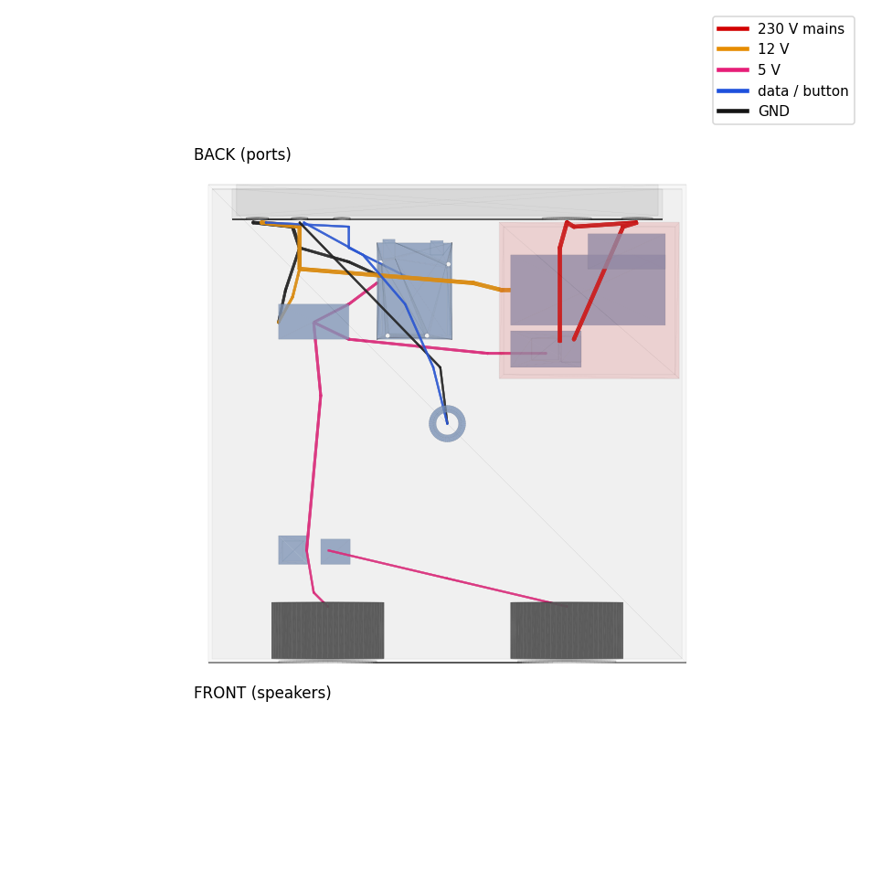

# Enclosure plan

Status: **block-out only**, no final CAD yet. The block-out models live in [`../cad/`](../cad/README.md). The idea is a record player: a fixed round platter (for looks, it does not turn) on a housing, with the electronics in the housing and the big button on a pipe rising from the platter centre.

## Layout (see `cad/make_blockout.py`)

| Item | Decision |
|------|----------|
| Housing | 340 x 340 x 100 mm block-out (will change, see "3D printing"), floor and front wall with the two speakers in one stiff piece |
| Speakers | Two round grilles on the front wall, left and right, so they look like part of the record player (hole 70 mm, speaker 80 mm assumed: check the datasheet) |
| Platter | Fixed disc, 315 mm, sits on top of the housing. Looks like a turntable, no motor |
| Button | 16 mm illuminated button in a cap on a hollow pipe (26 mm outside, 20 mm inside) from the platter centre; cable runs down the pipe into the housing |
| Arduino | Inside the housing. **USB-C is only reachable when the housing is opened** (no hole) |
| Back panel | A **recessed port pocket** (300 x 50 x 22 mm): mains inlet, outlet for the disco ball, strip connector, button connector and a spare, so plugs and cables do not stick out |
| Mains | Own compartment (own box and screw-on lid, wall to the low-voltage side) holding the C14 inlet with fuse, relay, 12 V brick and the Type 13 outlet |

## Cables are removable

- **Mains:** a standard cord (Swiss Type 12 plug on one end, IEC C13 on the other) into an IEC C14 panel inlet with a 5x20 mm fuse drawer. The relay switches the live wire to the Type 13 outlet for the disco ball.
- **LED strip:** GX16-4 panel socket in the pocket, 4-core 1.0 mm2 cable with plugs: 12 V, GND, data, second GND.
- **Button:** GX12-2 panel socket, the same cable type (2 of 4 cores): button signal and GND.
- Different connector sizes (GX16 and GX12) so they cannot be swapped by mistake. 12 V is only on the strip connector.
- Wiring: [wiring v3](wiring/README.md).

## Opening and cable organising

- **Main screws:** about 4 M3 screws into heat-set inserts. Remove them and the top lifts off. Leave slack in the cable that passes through the stem opening so the top can be put aside without unplugging.
- **One-way cable clips:** two ribs with a round channel between them and an **angled slit**: a cable is pressed in along the slope but cannot be pulled straight out. Test print: `cad/placeholders/cable_clip_test.stl` (channel 9 mm, slit 6 mm, angle 40 degrees, tune in `cad/make_placeholders.py`). Print in PETG.
- Keep mains cables apart from the low-voltage cables.

## 3D printing (Bambu Lab P1S)

Build volume 256 x 256 x 256 mm (the check in `make_blockout.py` uses 252 mm). The housing (340 mm) and the platter (315 mm) are too big for one print:

- Platter in 4 quarter segments, joined with tabs and screws.
- Housing as modular panels or shrunk to about 340 x 250 mm so the base halves fit the bed. Decision open.
- Mains compartment (about 128 x 111 x 70 mm) fits on the bed as it is.
- 3 mm walls, speaker holes vertical, no overhang over 45 degrees, front panel printed face down, PETG for the clips.

## Open points

- Speaker (measured): Garsent 3 inch full-range, 7.7 cm body, 9.7 cm across the mounting ears, 3.5 cm deep. The model uses these numbers; the frame cradle is 82 mm wide. Screw-hole spacing is not measured yet (?).
- Real sizes of the 12 V brick, buck converter, mains inlet, Type 13 outlet and connectors (block-out uses guesses marked "(guess)").
- Housing size and how it is split for printing.
- Ring: the DFR0888 ring is 12 LEDs (47 mm) but the code still says 16 LEDs on D4.
- Parts and prices: [BOM_enclosure.csv](../BOM_enclosure.csv) (besides the main [BOM.csv](../BOM.csv)).
- Forge also needs a STEP file and the CAD source of the final design.

## Interior with wires

Rough routing preview (generated by `cad/make_interior.py`, 3MF with one object per wire: `cad/placeholders/interior_with_wires.3mf`). Lid and platter hidden. Wire paths are planning routes, not exact lengths.

Red = 230 V (only inside the mains compartment, right), orange = 12 V, magenta = 5 V, blue = data and button, black = GND. The 12 V brick lead crosses the wall to the barrel jack that is already on the buck converter (no separate jack block); the 12 V input terminals of the buck feed the strip port (fused) and GND goes to the star block.

## How the mains part is isolated

- **Own box:** the mains compartment has its own walls and its own screw-on lid. The lid needs a tool, so the housing lid alone never exposes 230 V.
- **Wall to the low-voltage side:** only the 5 V relay coil wires and the 12 V brick lead cross it, through small holes with grommets or a printed slot sealed with a cable clip.
- **Only the live wire is switched** (fuse, relay COM, NO, outlet). Neutral and earth run straight through; earth is bonded to the outlet's earth contact.
- **Fuse:** 250 V AC rated holder and fuse, in the live wire right after the cable gland (no car fuses on 230 V).
- **Strain relief:** the mains cable goes through a gland (option A) or a fused C14 inlet (option B), so a pull never reaches the terminals.
- **Insulated connections:** Wago or screw terminals only, no open copper, spacing of several mm between live parts and the wall or the low-voltage side.
- **Double-insulated brick:** the 12 V brick has no earth wire; its low-voltage side stays below 50 V.
- **Material:** print the mains box in PETG at least (3 mm walls, 3+ perimeters). Flame-retardant material (e.g. PC-FR or a flame-retardant PETG) is better; PLA is not recommended there.
- **Before powering:** have the mains side checked by a qualified person (earth continuity, insulation, no loose strands). This is a hobby design, not a certified product.

## PLA or PETG (bright red PETG spool)

Use the red PETG. PLA softens at about 55 to 60 °C; inside the box the 12 V brick, buck converter and relay get warm and PLA can sag. PETG handles about 75 to 80 °C and is tougher (clips, screw posts). Bright red also suits the record player look: use it for the housing and platter. Print settings for PETG on the P1S: nozzle about 240 to 250 °C, bed about 70 to 80 °C, little part cooling, glue stick on the plate. Keep vents (slots) at the back above the brick for airflow.

## Shell and frame (two-part design)

- **Frame (PETG):** 3 mm base plate, Arduino standoffs at the datasheet holes, speaker saddles, the mains compartment walls and a separate mains lid. Everything electrical is mounted on it, so the shell can come off without touching a wire.
- **Shell (PLA, outside only):** walls, top, speaker grille holes, recessed port pocket, stem opening, side vent slots; no floor. It lifts straight up after removing 4 M3 screws from below (into heat-set inserts in the shell's corner columns).
- Generated by `cad/make_shell_frame.py`: whole parts (`shell.stl`, `frame.stl`, `mains_lid.stl`), print quarters (`shell_q1..q4.stl`, `frame_q1..q4.stl`, each fits the P1S) and `shell_frame_assembly.3mf`.
- Not modelled yet: joints between quarters (screw tabs or glue), clip rails, mounts for buck converter, DFPlayer, amp and brick, speaker retaining straps, a platter split.
- Cables to the ports run on the frame and through the port pocket, so with the shell removed the whole inside is open for repair.

## Module mounts, clips and the full model

- **Snap-fit cradles** on the frame for the DFPlayer, PAM8403 amp, buck converter (its barrel jack is on the board), 74AHCT125 board, GND block and relay: four 5 mm pads under the PCB corners, a flexible hook arm on each short end and a fixed lip on each long side. Press the board down and it clicks in; push the two arms outward to take it out. Sizes of the amp, buck, shifter and terminal blocks are guesses, so measure and edit `MODULES` in `cad/make_shell_frame.py`. Print arms in PETG; they flex across the layers, so make a test print of one cradle first.
- **12 V brick:** corner stops plus two cable-tie slots in the plate.
- **Cable clips:** seven small hook clips (about 11 x 6 x 9 mm: a post, an arm folded over the wires and a lip with a slanted slit) printed onto the frame at the port bundles and along the 5 V, speaker and button runs. Press the wires in through the slit; the arm flexes and holds them. Holds a bundle of about 6 mm (`CLIP_D`), positions in `CLIPS`; test print: `cad/placeholders/cable_clip_small.stl`.
- **Full model:** `python3 cad/make_full_assembly.py` writes `discobox_full.3mf` (coloured, one object per part: shell, frame, mains lid, platter, pipe, all module block-outs, wires) and `discobox_full.stl` (one merged mesh, no colour).

## Record-player look (flat platter, tilted record, hollow pipe)

`cad/make_recordplayer.py` (used by `make_full_assembly.py`):

- **Flat platter** (270 mm, centred on the deck) and slip mat lie on the deck where a record normally lies. The pipe passes through its centre.
- **Tilted record:** 300 mm (12 inch), printed, 40 degrees as in the starter model, facing the front. Label 100 mm = hub size. The LED ring block-out from the starter model (OD 70) sits in a pocket in the back; the red button is in the centre. Lowest rim is about 30 mm above the mat, so nothing touches.
- **One hollow pipe:** OD 60, ID 48, vertical out of a socket collar in the frame, one smooth bend of 40 degrees (centre-line radius 70 mm), a short taper and a 100 mm hub on the back of the record like the Abwinklung of the starter model. The cables (button, LED ring) run through it. It slides out of the top after loosening 2 M3 set screws in the collar; use a small plug at the foot of the pipe so the cables can be unplugged. The shell opening is 66 mm at the centre of the deck (0, 0).
- **Hull:** four feet, control panel with three knobs (decorative for now) and a slider, tonearm with pivot at the right rear (the usual place), counterweight, headshell and rest, dust-cover hinges.
- Real turntables use 222 mm from pivot to spindle; here the arm is shorter because the housing is 340 mm. Web search found no free STL I could copy, so the layout follows the usual turntable arrangement ([Clearaudio manual](https://www.manualslib.de/manual/229567/Clearaudio-Tracer.html?page=6), [StereoNet thread on 222 mm](https://www.stereonet.com/forums/topic/61437-rega-spindle-to-pivot-distance/)).
- The record does not spin (no motor). Preview images: `doc/img/recordplayer_*.png` (`python3 cad/render_preview.py`); the simple renderer shows some sorting glitches that are not in the 3MF.
- The 315 mm parts are too big for the P1S: print platter and record in quarters (not split yet).

## Top of the record from the starter model (exact LED ring positions)

The record head now uses the parts of `Shalplatte_Discobox.3mf` 1:1 (exported to `cad/starter/`: `led_holder.stl`, `test_top.stl`, `led_ring.stl`). Nothing about the ring pocket, ring width (OD 70) or the distance between ring and diffuser plate (ring top at +2 mm, plate bottom at +10 mm, so 8 mm) is changed; only the outer edge of the holder is trimmed from 315 to 300 mm and everything is shifted so the front face is at zero. The label (100 mm) sits on the diffuser plate, the button in its 16 mm hole.

Product picture (light blue background): `doc/img/recordplayer_product.png`; on a side table: `recordplayer_scene.png` (`python3 cad/render_scene.py`).

## Design requirements: starter model and now

The starter model (`cad/starter/Shalplatte_Discobox.3mf`, version v2 in the [3D viewer](viewer/discobox_viewer.html)) was a 315 mm platter with the LED ring, an angled stem and the Arduino in a holder below. The requirements have been improved step by step:

| Requirement | Starter model | Now (v5) |
|-------------|---------------|----------|
| Where the Arduino sits | In a holder under the stem | Inside the housing on the frame; USB-C only reachable when opened |
| Housing | None | Record-player housing that fits everything comfortably, speakers visible on the front |
| Platter and record | One 315 mm disc | Flat platter on the deck, tilted 300 mm record (40 degrees), label and hub 100 mm |
| LED ring | Ring pocket in the disc | Same top part 1:1: pocket, ring width and ring-to-diffuser distance (8 mm) unchanged |
| Pipe | Short angled stem | One hollow bent pipe, cables run through it, removable from the top |
| Mains | Not planned | Separate mains compartment with its own lid, fuse and relay |
| Cables | Not planned | Recessed back pocket with removable GX connectors; one-way cable clips and routes |
| Opening and repair | Not planned | A few screws, shell lifts off the frame, snap-fit module mounts |
| Printing | Not checked | Parts split into quarters that fit the Bambu P1S bed (platter and record still to split) |

## Cable holes and clips in the model

Added to the frame (`cad/make_shell_frame.py`), checked by cutting test points through the mesh:

- **Mains compartment wall:** two pass-through holes to the low-voltage side: 10 mm for the 12 V brick lead and 8 mm for the 5 V relay coil wires. Use a grommet or a cable clip next to each hole so a pull never reaches the terminals.
- **Mains compartment back wall:** two holes in line with the ports in the recessed pocket: 22 mm for the mains inlet and 35 mm for outlet B (the disco ball).
- **Pipe collar:** a 20 mm wide cable exit slot at the foot, where the cables come out of the hollow pipe and run along the frame.
- **Clips:** three more one-way hook clips next to these holes (10 clips in total). Positions are in `CLIPS`; hole positions are in `frame()`.
- Not modelled yet: grommets, and a strain-relief clamp for the mains cable inside the compartment.

## Plugs, cables and interactive wiring

- The model has plugs in the back pocket: GX16 (strip) and GX12 (button) plugs on their sockets, a cable gland for the mains cable, outlet B (Type 13) with the disco-ball plug pushed in, and a cap on the spare port. They are in the viewer group "Plugs and cables (not printed)".
- External cables are modelled at their real length as coils behind the box: strip cable 2.2 m, button cable 2.2 m, mains cable 5 m. The model checks that each centre line is exactly that long. The disco-ball cable length is not fixed yet (?). The full list with internal wire lengths is in [CABLES.md](CABLES.md) (`python3 cad/make_plugs.py` rewrites it).
- The barrel jack is on the buck converter, so there is no separate jack block any more: the 12 V brick plugs straight into the buck, and the fused 12 V for the strip and the GND star block are taken from its terminals.
- `doc/wiring/interactive.html` (site page "Interactive wiring") is a clickable schematic. Click a wire or a part and the same wire lights up in the embedded 3D viewer; picking a wire in the viewer's "Highlight" list selects it in the schematic. Rebuild with `python3 cad/make_wiring_interactive.py` (wires come from `cad/make_interior.py`, so model and schematic stay in sync).
- Printing: all printed parts are closed solids. The hollow pipe has a few near-coincident vertices (about 1e-5 mm apart) from the boolean step; slicers repair that silently (check once in your slicer).

## Versions in the viewer, 80s colours, mains path

- The 3D viewer has three current versions: **v6 no cables** (record player with the plugs in the pocket), **v6 with cables** (plus the 2.2 m, 2.2 m and 5 m cables and the 3 m WS2805 strip with its 180 LEDs coiled at the end of the strip cable, and the 16 mm button at the end of the button cable) and **v6 interactive**, which is the same model with a Disco button (or click the button on the record): LED ring, diffuser, button and strip colour-cycle slowly, with no flashing.
- Product colours follow the 80s theme: magenta shell, cyan frame and knobs, yellow mains lid, purple platter and record, orange label. These are filament colour suggestions only.
- Mains path: inlet and fuse, then (a) live through the relay to outlet B, neutral straight through, and (b) live and neutral into the 12 V brick. The brick is in the mains compartment; only its 12 V lead crosses the wall to the barrel jack on the buck converter.
- The amp gets a pair (+5 V and GND) from the buck and passes it on to the DFPlayer Mini; the DFPlayer audio goes to the amp inputs, the Arduino talks to the DFPlayer on Serial1 (D0/D1), and each speaker has its own pair.
- Button and ring on the record: the 16 mm RGB button has 6 wires (2 for the switch: D2 and GND; one each for red D3, green D5, blue D6; one common ground for the three LEDs) and the 16-LED WS2812 ring has 3 wires (5 V, GND, data D4 through 330 Ohm). All 9 wires run from the box up through the hollow pipe to the record head. The pipe is only a conduit now, not a button contact. Because the pipe is removable, a small plug (for example a 9-pin connector, size to be chosen) is needed at its base. The wires are in the 3D model and in the interactive wiring.
- The 2.2 m cable on the GX12 port belongs to a separate big red arcade button (about 60 mm), not to the RGB button on the record. It only needs 2 wires (signal and GND), so the 4-core cable and GX12-2 plug are enough. Its Arduino pin is not chosen yet (?); D8 is free. The firmware has only one button at the moment (D2), so the red button needs firmware support.

- Viewer settings: the version tabs now only pick the design stage (v6, v4, v3, v2). For v6 the **Settings** box has separate switches for the interactive disco button, the add-ons (plugs, cables, 3 m LED strip) and a drawings-only view (wires, electronics, mains compartment, speakers, plugs); "No cables" and "With cables" are one-click presets. The record button is now a 16 mm model with a metal bezel and a domed cap that moves in when you press it (click it in 3D, or use the Disco button). The viewer and the wiring pages use the Novaroma colours with 80s accents.
- Knobs, control plate, slider, platter, tonearm (with headshell, cartridge, stylus) and hinges belong to the shell: the viewer lists them under "Shell (PLA)" and they print with it (multi-colour or painted: cyan knobs, yellow pointers, pink slider, purple platter). The knobs now stand on a visible 2 mm skirt ring on a raised 4 mm plate that lies fully on the deck; the slider track sits on the deck instead of floating 1.5 mm above it; the tonearm tube is 8 mm thick so it can be printed. Only the record, the pipe, the feet and the add-ons are separate parts.
- Add-ons in the viewer: "cables, plugs and big red button" are one group; the big red button is a quiz-buzzer / e-stop style part (90 mm base, 70 mm dome) at the end of the 2.2 m cable. The 20 cm disco ball (own switch) stands behind the box, its cord plugged into outlet B on the back. In disco mode the viewer background is now a lighter purple and dark parts get extra light, so nothing disappears into the dark.
- The big red button on its cable is meant to go straight to disco mode (firmware to do: new pin, for example D8, starts Party mode / disco). In the interactive viewer, click it (cables add-on on) or the pink button on the record to toggle the disco; both press in.
- Plugs and cables are separate groups now: the plugs in the back pocket (GX16, GX12, cable gland, outlet B, spare cap) are always shown; the cables, their far-end plugs and the big red button are one add-on. The side table has two variations: a round one for the plain model and an extended one (1.5 m x 1.15 m) that the viewer switches to when cables, strip or disco ball are on.
- Tonearm head simplified for printing: the headshell is one 36 x 16 x 6 mm block straight along the arm (no 15 degree offset), the cartridge is one 22 x 12 x 6 mm block under it, and an 8 mm post under the arm end holds the arm up so it does not hang free while printing. Stylus, finger lift and screw slots are gone.
- Viewer fix: turning the disco on made the viewer stop (a missing colour function stopped the draw loop, so nothing could be dragged and parts seemed to vanish). That is fixed; I tested the viewer script with a mock browser through disco on/off, all settings, the highlight list and version switching without errors.
- Add-ons are independent now: mains cable, LED strip (with its cable), big red button (with its cable) and motor disco ball (with its cord) each have their own switch, and each brings only its own cable. The plugs in the back pocket are always shown. The big red button now sits beside the box (left side, on the table) with its 2.2 m cable over a small coil; the cable length is still exactly 2.2 m.
- Disco mode effects in the viewer: glowing halos around the ring, strip and ball, slow laser beams from the ball (or the ring), and music notes that rise from the two speakers and the record. Beams and notes are slow and soft (no flashing); with "reduce motion" set in the browser the beams are off.
- Buck converter (measured): 6 x 3 cm, 2 cm high, with the terminals at the two short ends: 12 V input (with the barrel jack) at the left end, 5 V output at the right end. The block-out, the frame cradle (60 x 30 mm) and the wires now use these numbers; the 12 V lead from the brick goes round the back of the buck to the left end, and all 5 V wires leave from the right end.
- 12 V brick (measured): 19 cm long including the space for the plugged-in DC cable end (not the whole cable), 6 cm wide, 4 cm high. It does not fit across the old mains compartment, so the compartment is now 195 mm deep (y from -55 to 140, still 122 mm wide): the brick lies along Y with its AC end at the back near the inlet and its DC plug end at the front. The 12 V lead leaves through a new 10 mm hole in the compartment front wall and runs round the front of the pipe collar to the buck's left end. Relay and inlet moved to the back right of the compartment. The mains lid is now about 128 x 201 mm (fits the P1S bed).
- Piezo buzzer (measured): 3 x 3 x 1.5 cm built-in speaker with a mounting lug with a screw hole on one side. The lug is not counted in the 3 x 3 size. It sits on a 4 mm platform on the frame at the left (x -150, y -35) with a screw boss under the lug (M2.5 pilot hole, guess); wires D9 and GND are in the model and in the interactive wiring.

## Standing next to a sink in a washing room (splash, humidity and mains safety)

I am not an electrician. These are design notes and things to check, not a safety approval; mains work needs a qualified person and local rules (in Switzerland: ask an electrician about the rules for sockets near sinks).

- **RCD:** the box switches 230 V for the disco ball, so plug it into a socket that is protected by a 30 mA residual-current device (FI), or use a plug-in PRCD. This is the single most important item near water.
- **Where to stand it:** keep the back (ports) and the mains cable away from the splash zone, with the cables hanging down below the sockets so drips fall off (the leads in the model already curve down, which gives a drip loop). Do not put it where the tap can hit it.
- **Weak spots in the housing:** (1) the 66 mm pipe opening in the deck lets water run in around the collar: add a soft skirt or O-ring on the pipe; (2) the two side vent slot groups and the speaker grilles are open; the grille rings are narrow (4 mm) but not waterproof, so mount the box with the vented sides facing away from the sink; (3) the mains compartment lid is a plain flat lid: add a 2 mm O-ring cord in a groove or a thin foam gasket if you want it splash-proof (say if you want the groove modelled).
- **Mains parts:** use the IP55 outlet B already in `BOM_enclosure.csv`, a proper cable gland (IP-rated) on the mains cable, and keep all mains wiring inside the closed compartment (it is separated from the low-voltage side by its own walls).
- **Material:** PLA softens around 55 degrees and can absorb moisture over time; PETG is the better choice for the shell too if it stays in a kitchen (the frame is already PETG).
- **Cleaning:** wipe with a damp cloth only with the plug pulled out; never spray or rinse it.
- **Speakers:** now modelled properly (flange with the 4 screw holes, rubber surround, cone, dust cap, basket, magnet) and covered by a printed grille: four concentric ring slots held by two diagonal spokes, with the 4 screw holes in the corners of each speaker.

### Washing room additions

- **Humid and warm air:** a laundry room has condensation, detergent vapour and lint. Spray conformal coating (or clear lacquer, not on connectors or the relay contacts) on the Arduino, buck, amp, DFPlayer and the perfboard, and put a small silica-gel bag in the low-voltage side. Do not coat anything in the mains compartment without checking the product.
- **Heat:** do not stand it on or next to a tumble dryer or radiator. PLA softens near 55 degrees; print the shell in PETG (about 75) or, if it sits close to a dryer, ASA (about 95).
- **Lint and splashes:** glue fine insect mesh behind the side vent slots (inside the shell) so lint and drops do not get onto the brick; the vents can then stay open for the brick's heat.
- **Vibration:** do not put it on a washing machine. On a shelf, the rubber feet are enough; the speaker is held by the frame, not by the shell.
- **RCD:** the 30 mA FI / PRCD from the sink notes is a must here. Use only the IP55 outlet and an IP-rated cable gland, and keep the mains cable off the floor where water can pool.
- **Speaker holders (no screw holes outside):** the frame now rises into a 6 mm baffle plate right behind the shell's front wall. The speaker is screwed to the back of the baffle from inside (screws through the flange holes into blind 2.6 mm pilot holes, 1 mm skin left at the front), so the shell front is clean and the only openings are the grille rings. The shell lifts off with the speakers staying on the frame, which makes taking it apart easier. A saddle behind the rubber surround carries the weight of basket and magnet.

### Grille and shell character

- **Grille:** each speaker now has a hex-perforated grille (about 120 hexagonal holes, 4.6 mm across, 5.6 mm pitch, solid centre boss and rim) inside a 0.8 mm deep round bezel recess. Every bar is at least 1 mm, so it prints without supports when the front wall is printed vertical or lying on its back.
- **Shell sides:** rounded vertical corners (R6), a 2 mm chamfer round the top edge, a stepped-in base (bottom 7 mm, 1.2 mm in), three pinstripe grooves (2.4 mm wide, 1.2 mm deep) on the sides and the back, recessed panels around the side vents, and a nameplate recess between the speakers on the front. All details only cut into the outside (at most 1.2 mm of the 3 mm wall), so the frame, the columns and the inside dimensions are unchanged. Tip: print a colour change at the groove heights, or paint the grooves, for the 80s look.

### Viewer on phones and the menu
- The viewer menu is collapsible: "Hide" closes it, the "Menu" button (top left) opens it again, Esc closes it. On phones (narrow screens) it starts closed and opens as a drawer over the model.
- Touch: one finger rotates, two fingers pinch to zoom and move, tap the pink button or the big red button for disco mode; buttons and checkboxes get bigger tap targets on touch screens; "Reset" in the View row resets the camera.
- The drawings-only view keeps the LED ring and the RGB button (with its bezel) besides the wires, electronics, mains compartment, speakers and plugs.
- The interactive wiring page, the site menu and the embedded viewer pages are responsive (the wiring page stacks the schematic and the 3D view on narrow screens; wires have a wide tap area).
