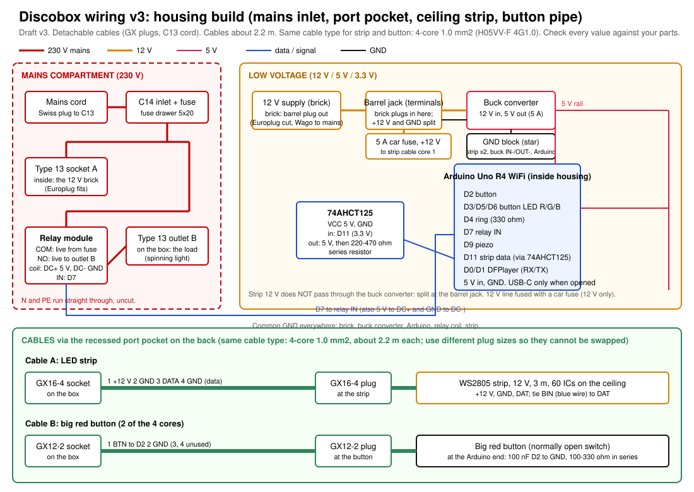

# Wiring diagrams

Open [index.html](index.html) in a browser and switch between the versions with the buttons at the top.

| Version | File | What it shows |
|---------|------|---------------|
| v3 (current plan) | [wiring_v3.svg](wiring_v3.svg) | Housing build: detachable mains cord (Swiss plug to C13) into a C14 inlet with fuse, relay and Type 13 outlet in their own mains compartment, 12 V brick, 74AHCT125 level shifter, port pocket with GX16 (strip) and GX12 (button) connectors, Arduino inside the housing, button on a pipe |
| v2 | [wiring_v2.svg](wiring_v2.svg) | Internal 12 V brick, relay with Swiss plug and socket, level shifter, ceiling strip and button on separate cables |
| v1.2 (first plan) | [wiring_v1.2.png](wiring_v1.2.png) | First plan from the breadboard phase |

To add a version: copy the file into this folder and add one line to `VERSIONS` in `index.html` and one row to the table above.

`../../Discobox_Wiring.puml` is the software object diagram (not an electrical diagram), see also `../../Discobox_Architecture.puml`. The housing and parts layout is described in [../ENCLOSURE.md](../ENCLOSURE.md).
